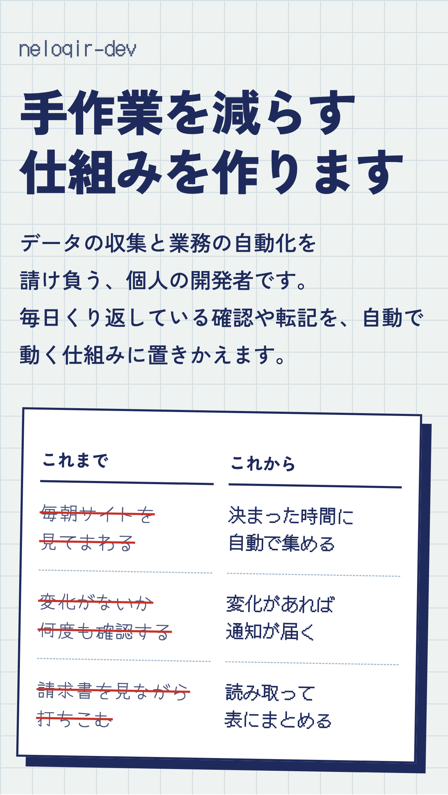
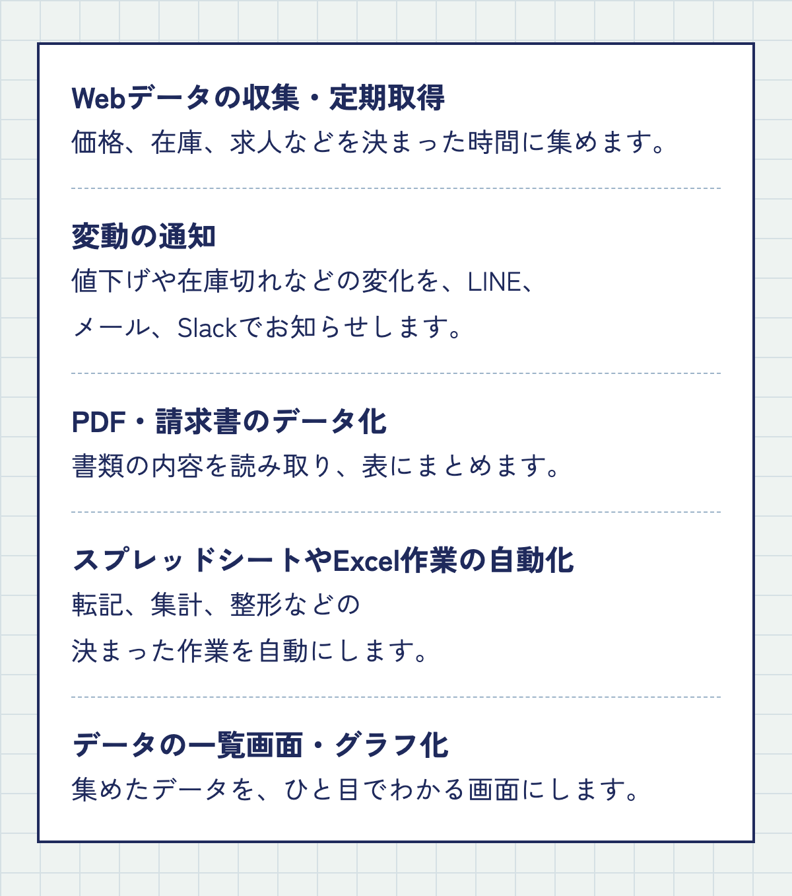
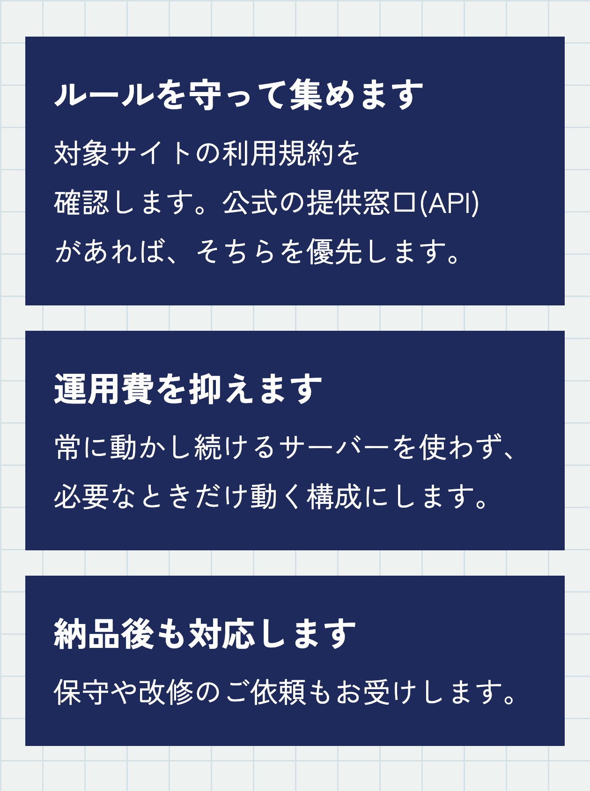

  

## 対応できる仕事

  

「これは頼めるのか」という段階のご相談も歓迎です。

## 作品

| 名前 | 何を解決するか | デモ |
| --- | --- | --- |
| 準備中 | 準備中 | 準備中 |

公開できしだい、ここに追加します。

## 進め方と強み

  

## 自社サービス

受託開発とは別に、自社サービスも開発しています。
[neloqir](https://github.com/neloqir) で公開しています。

## ご依頼・ご相談

  

連絡先:[info@neloqir.com](mailto:info@neloqir.com)
